 

**Software Engineer in the making — focused on building software that works beyond the demo.**

Python backend · APIs & system design · Applied AI · Cloud fundamentals

  
  
  

---

## About

I'm a computer science undergraduate who enjoys turning ideas into working backend services and thoughtful developer-facing products. My work spans REST APIs, data pipelines, optimization, graph algorithms, and practical AI features.

- **Engineering focus:** Python, FastAPI, clean API contracts, testing, and maintainable services.
- **Currently exploring:** distributed systems, AWS, Docker, CI/CD, and production-minded AI engineering.
- **Background:** B.Tech Computer Science, BPIT (GGSIPU), New Delhi · **Class of 2028** · Software engineering internship experience (Apr–Jul 2026).
- **Opportunities:** Open to software engineering, backend, applied AI, and cloud engineering internships.

## Selected work

Four projects that best represent how I approach different engineering problems. Each links to a public source repository.

### 01 / [RoofShift AI](https://github.com/rajsalonia/roofshift-ai) — optimization & energy intelligence

**Problem:** How do you prioritize rooftop solar investments when multiple buildings share a limited budget?

Built a full-stack solar planning platform combining geospatial assessment, energy estimates, and **constrained portfolio budget optimization**. The system links physical assumptions to a decision workflow rather than just displaying dashboards.

`FastAPI` · `React` · `TypeScript` · `optimization` · `Docker`

[Explore source & architecture](https://github.com/rajsalonia/roofshift-ai) · [Project demo](https://d2pxwgtcwn203c.cloudfront.net/)

### 02 / [JudgeForge](https://github.com/rajsalonia/JudgeForge) — backend design & reliable workflows

**Problem:** How can hackathon teams submit projects and be evaluated fairly, with transparent rules and judge isolation?

Developed a self-hosted workflow with role-based access, rubric scoring, **cross-judge score normalization**, audit trails, and CSV exports. Its repository documents automated acceptance and test checks.

`Python` · `FastAPI` · `SQLite` · `RBAC` · `testing`

[Explore source & verification](https://github.com/rajsalonia/JudgeForge) · [Evaluation demo](https://judgeforge.onrender.com/)

### 03 / [CityGraph](https://github.com/rajsalonia/citygraph) — graph algorithms & geospatial systems

**Problem:** How can interdependent city infrastructure failures be modeled and explored before they cascade?

Created a graph-based decision-support prototype for **failure propagation**, flood-scenario exploration, map-based inspection, and risk-aware route planning using synthetic data.

`FastAPI` · `React` · `NetworkX` · `Leaflet` · `graph algorithms`

[Explore source & modeling approach](https://github.com/rajsalonia/citygraph) · [Project demo](https://citygraph-intelligence.vercel.app/)

### 04 / [BoloAI](https://github.com/rajsalonia/BoloAI) — multilingual agent systems

**Problem:** How can digital assistance work naturally for Hindi, Hinglish, and English speakers?

Built a voice-first assistant prototype with conversational context, intent-based tool orchestration, and configurable speech/telephony integrations. The code distinguishes real provider connections from mocked fallbacks.

`Python` · `FastAPI` · `agent orchestration` · `speech interfaces`

[Explore source & integration status](https://github.com/rajsalonia/BoloAI) · [Project demo](https://boloai-web.onrender.com/)

Hosted demos may vary in availability. Repositories are the source of truth for implementation details, setup instructions, and integration status.

## Engineering toolkit

| Domain | Technologies & practices |
| :-- | :-- |
| **Languages** | Python · TypeScript · JavaScript · SQL · C++ (learning) |
| **Backend** | FastAPI · REST APIs · Pydantic · SQLAlchemy · SQLite · API design |
| **Frontend** | React · Vite · Tailwind CSS (for full-stack project interfaces) |
| **AI & data** | scikit-learn · NumPy · NetworkX · model/API integrations |
| **Cloud & delivery** | Docker · Git · GitHub Actions · AWS fundamentals · CI/CD |
| **Engineering habits** | Testing · reproducibility · documentation · failure handling |

**More experiments:** [ReviewLens](https://github.com/rajsalonia/ReviewLens) (evidence-based comparisons) · [Proofly](https://github.com/rajsalonia/document-forgery-ai) (explainable document-risk checks).

## Open-source & GitHub activity

I use GitHub to document decisions, publish implementations, and iterate on real projects. Browse my [public repositories](https://github.com/rajsalonia?tab=repositories), [contribution history](https://github.com/rajsalonia?tab=overview), or [GitHub achievements](https://github.com/rajsalonia?tab=achievements).

<!-- SNAKE:START -->

<picture>
  <source media="(prefers-color-scheme: dark)" srcset="https://raw.githubusercontent.com/rajsalonia/rajsalonia/output/snake-dark.svg">
  
</picture>

<!-- SNAKE:END -->

Contribution animation reflects public GitHub activity. It is generated by a repository workflow, not a manually entered score.

---

### Interested in working together?

I'm exploring internship opportunities where I can contribute to backend infrastructure, APIs, cloud services, or AI-enabled products — and learn from engineers building reliable software.

[**Portfolio**](https://raj-salonia-portfolio.vercel.app/) · [**LinkedIn**](https://www.linkedin.com/in/rajsalonia) · [**Resume**](portfolio-site/Raj_Salonia_Resume.pdf)

New Delhi, India · B.Tech CSE 2028

