<picture>
  <source media="(prefers-color-scheme: dark)" srcset="assets/banner-dark.svg">
  <source media="(prefers-color-scheme: light)" srcset="assets/banner-light.svg">
  
</picture>

 

**Software Engineer focused on Python backend architecture, high-throughput APIs, and practical AI systems.**

Python Backend · FastAPI &amp; System Design · Applied AI · Cloud Fundamentals

  
  
  

---

## About

I am a computer science undergraduate at BPIT (GGSIPU), New Delhi (**Class of 2028**), specializing in backend software engineering, API architecture, and applied AI systems. I build backend services that prioritize correctness, defensive error handling, test coverage, and transparent data modeling over surface-level demos.

- **Backend Engineering:** Python, FastAPI, Pydantic, SQLite (WAL mode), asynchronous concurrency, and strict REST API design.
- **Applied AI & Computation:** Graph algorithms, constrained budget optimization (MCKP), diurnal solar analytics, and domain-grounded agent orchestration.
- **Cloud & Systems:** Docker containerization, AWS fundamentals (EC2, S3, CloudFront), Linux/Bash, and automated CI/CD pipelines via GitHub Actions.
- **Opportunities:** Actively seeking **Software Engineering Internships** to contribute to production backend services, APIs, and computational infrastructure.

---

## Featured Engineering Projects

Four production-style implementations demonstrating backend architecture, mathematical modeling, and defensive engineering.

### 01 / [RoofShift AI](https://github.com/rajsalonia/roofshift-ai) · Solar Modeling & Budget Optimization Platform

> **Geospatial rooftop solar assessment and capital allocation engine using operations research under fixed institutional budget limits.**

- **Problem Statement:** Multi-building organizations (university campuses, commercial facilities) face capital misallocation when evaluating rooftop solar due to siloed geospatial data, naive heuristics (e.g. simply selecting the largest roof), and inaccurate payback projections that ignore diurnal load coincidence.
- **Engineering Solution:** Built an end-to-end solar intelligence platform integrating NASA POWER climatological irradiance, interactive GIS rooftop polygon extraction, diurnal generation-consumption coincidence modeling, and asset degradation diagnostics.
- **Technical Differentiator:** Formulates multi-building rooftop capital allocation as a **Multiple-Choice Knapsack Problem (MCKP)** using a deterministic operations-research solver to maximize aggregate portfolio yield under hard budget ceilings.
- **Technology Stack:** `Python 3.11+` · `FastAPI` · `React 18` · `TypeScript` · `Vite` · `Tailwind CSS` · `NASA POWER API` · `XGBoost` · `Docker Compose`
- **Links & Evidence:** [GitHub Repository](https://github.com/rajsalonia/roofshift-ai) · [Live Demonstration](https://d2pxwgtcwn203c.cloudfront.net/) · [API Contracts](https://github.com/rajsalonia/roofshift-ai/blob/main/API_CONTRACTS.md)

---

### 02 / [JudgeForge](https://github.com/rajsalonia/JudgeForge) · Self-Hosted Fair Hackathon & Evaluation Engine

> **Resilient, zero-cloud-dependency hackathon management platform with server-enforced role isolation, statistical normalization, and cryptographic audit trails.**

- **Problem Statement:** Competitive hackathons suffer from evaluator bias, score calibration variance across judges (strict vs. lenient), lack of judge isolation, and external cloud platform downtime during critical submission and judging windows.
- **Engineering Solution:** Architected an offline-capable, single-server hackathon operations system with server-enforced role-based access control (`organizer`, `judge`, `participant`), peer review isolation (HTTP 403 on unauthorized peer inspections), rubric scoring anchors, and immutable audit logs.
- **Technical Differentiator:** Implements **cross-judge Z-score standardization** ($z = \frac{x - \mu_j}{\sigma_j}$) rescaled to the 1.0–5.0 competition scale with zero-variance review protection ($\sigma_j = 0$), paired with offline-verifiable **Ed25519 digitally signed** judge records (`cryptography`).
- **Technology Stack:** `Python 3.12` · `FastAPI` · `SQLite (WAL mode)` · `Pydantic` · `Docker` · `Ed25519 Cryptography` · `Pytest (80/80 passing)`
- **Links & Evidence:** [GitHub Repository](https://github.com/rajsalonia/JudgeForge) · [Evaluation Demo](https://judgeforge.onrender.com/) · [Scoring Methodology](https://github.com/rajsalonia/JudgeForge/blob/main/JUDGING.md) · [Architecture Spec](https://github.com/rajsalonia/JudgeForge/blob/main/ARCHITECTURE.md)

---

### 03 / [CityGraph](https://github.com/rajsalonia/citygraph) · Urban Infrastructure Risk Intelligence

> **Graph-theoretic decision-support system simulating cascading infrastructure collapse and risk-weighted emergency routing during extreme weather.**

- **Problem Statement:** Urban critical infrastructure systems (stormwater pumping stations, power substations, arterial roads, and hospitals) are interdependent. Extreme climate stresses propagate failures across sectors, but conventional emergency dashboards only display static, isolated sensor maps.
- **Engineering Solution:** Developed a graph-based simulation platform modeling Delhi infrastructure dependencies and historical flood events (e.g. July 2023 Yamuna flood), combining topological dependency graphs with spatial GIS overlays to visualize failure propagation and corridor vulnerabilities.
- **Technical Differentiator:** Employs a **NetworkX graph dependency engine** to compute cascading stress propagation and solves **risk-weighted shortest paths** for emergency response teams that dynamically penalize flooded corridors and failed substation zones.
- **Technology Stack:** `Python 3.11+` · `FastAPI` · `NetworkX` · `Shapely` · `React 19` · `Leaflet` · `Cytoscape.js` · `Vite` · `SQLite`
- **Links & Evidence:** [GitHub Repository](https://github.com/rajsalonia/citygraph) · [Interactive Demo](https://citygraph-intelligence.vercel.app/) · [Architecture Spec](https://github.com/rajsalonia/citygraph#system-architecture)

---

### 04 / [BoloAI](https://github.com/rajsalonia/BoloAI) · Multilingual Voice-First Agentic Assistant & Verifier

> **Voice-first agentic assistant engineered for Hindi, Hinglish, and English vernacular with conversational session memory, telephony adapters, and domain audit guardrails.**

- **Problem Statement:** Conversational voice assistants frequently fail on Indic dialects, hallucinate unverified public benefits/scholarship information, and lack graceful degradation when telephony or external cloud APIs experience disruptions.
- **Engineering Solution:** Engineered a voice-first agentic service supporting real-time streaming audio (8kHz L16 PCM WebSockets), multi-turn session context, and intent routing, designed with a clean abstraction layer separating live telephony (Exotel) and speech engines (Sarvam AI) from deterministic local mocks.
- **Technical Differentiator:** Clean **architectural decoupling** of telecom and speech adapters from deterministic mock fallbacks, paired with an automated **official domain auditor (`.gov.in` / `.nic.in`)** that verifies claims before returning responses.
- **Technology Stack:** `Python 3.10+` · `FastAPI` · `WebSockets` · `Sarvam AI (STT/TTS)` · `Exotel Telephony` · `Pydantic` · `Pytest (94 items)`
- **Links & Evidence:** [GitHub Repository](https://github.com/rajsalonia/BoloAI) · [Hosted Demo](https://boloai-web.onrender.com/) · [Integration Status Matrix](https://github.com/rajsalonia/BoloAI#truthful-provider-status)

Hosted demos are lightweight evaluation instances. Repositories serve as the source of truth for architectural specifications, test fixtures, and verification commands.

---

## Technical Skills

Categorized by demonstrated hands-on engineering in source repositories versus active exploration.

| Domain | Demonstrated in Projects | Active Exploration & Study |
| :--- | :--- | :--- |
| **Languages** | `Python (3.10–3.12)` · `TypeScript` · `JavaScript (ES6+)` · `SQL` | `C++` (Systems & Data Structures) |
| **Backend & APIs** | `FastAPI` · `Pydantic` · `RESTful API Design` · `Uvicorn` · `SQLite (WAL mode)` · `WebSockets` · `RBAC` | Distributed Systems · PostgreSQL · Redis |
| **AI & Computational Systems** | `Operations Research (MCKP)` · `NetworkX (Graph Algorithms)` · `scikit-learn` · `Agent Tool Orchestration` · `Speech Pipelines` | Multi-Agent Consensus · Vector Embeddings / RAG |
| **Cloud & DevOps** | `Docker` · `Docker Compose` · `GitHub Actions (CI/CD)` · `AWS Fundamentals (EC2, S3, CloudFront)` · `Linux / Bash` | AWS Lambda · Terraform · Kubernetes |
| **Engineering Practices** | `Automated Testing (Pytest)` · `Defensive Architecture` · `API Contract Verification` · `Ed25519 Cryptography` · `Audit Logging` | SRE Practices · Performance Profiling |

---

## Open-Source & Contribution Activity

I use GitHub to maintain clean engineering hygiene: publishing reproducible code, writing automated test suites, documenting system constraints, and maintaining active deployment pipelines.

<!-- SNAKE:START -->
<picture>
  <source media="(prefers-color-scheme: dark)" srcset="https://raw.githubusercontent.com/rajsalonia/rajsalonia/output/snake-dark.svg">
  
</picture>
<!-- SNAKE:END -->

Contribution animation reflects public GitHub activity, automatically generated via scheduled GitHub Actions workflow.

---

### Connect & Collaborate

I am actively seeking **Software Engineering Internships** where I can contribute to backend services, API infrastructure, optimization problems, and practical AI applications.

  
  
  

New Delhi, India · B.Tech in Computer Science & Engineering (Class of 2028)

