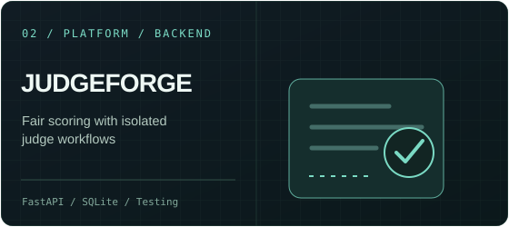
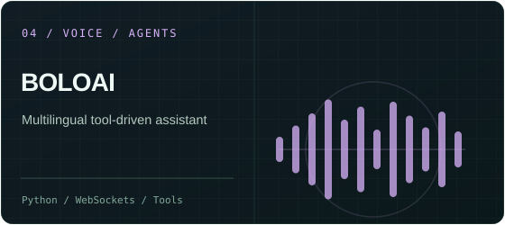

<picture>
  <source media="(prefers-color-scheme: light)" srcset="assets/showcase-hero-light.svg">
  
</picture>

 

&nbsp;
&nbsp;

### Hey, I'm Raj 👋

I'm a **computer science undergraduate (2028)** in New Delhi, building practical software with a focus on **Python backends, APIs, applied AI, and cloud fundamentals**.

I enjoy solving engineering problems that involve more than a polished interface — reliable services, good abstractions, thoughtful testing, and measurable technical decisions. Currently exploring software engineering internship opportunities.

### Selected engineering work

<table>
<tr>
<td width="50%" valign="top">

 <b>Solar planning, made actionable.</b> 
Geospatial assessment, energy modeling, and constrained budget optimization across rooftops.  
<a href="https://github.com/rajsalonia/roofshift-ai">Source &amp; architecture ↗</a> · <a href="https://d2pxwgtcwn203c.cloudfront.net/">Demo ↗</a>
</td>
<td width="50%" valign="top">

 <b>Fair judging, defensible by design.</b> 
Self-hosted evaluation platform with role isolation, audit trails, score normalization, and automated tests.  
<a href="https://github.com/rajsalonia/JudgeForge">Source &amp; architecture ↗</a> · <a href="https://judgeforge.onrender.com/">Demo ↗</a>
</td>
</tr>
<tr>
<td width="50%" valign="top">

 <b>Understand what fails next.</b> 
Graph-based infrastructure risk simulation, geospatial visualization, and risk-aware routing.  
<a href="https://github.com/rajsalonia/citygraph">Source &amp; architecture ↗</a> · <a href="https://citygraph-intelligence.vercel.app/">Demo ↗</a>
</td>
<td width="50%" valign="top">

 <b>Voice-first assistance for Bharat.</b> 
Hindi/Hinglish/English conversational workflows with tool orchestration and configurable speech adapters.  
<a href="https://github.com/rajsalonia/BoloAI">Source &amp; architecture ↗</a> · <a href="https://boloai-web.onrender.com/">Demo ↗</a>
</td>
</tr>
</table>

These are engineering prototypes and portfolio demos, not claims of production-scale deployment. External services may have mock or fallback integrations; see each repository for details.

### My toolbox

| What I build with | Technologies |
| :-- | :-- |
| **Languages** | Python · TypeScript · JavaScript · SQL · C++ (learning) |
| **Backend** | FastAPI · Pydantic · REST APIs · WebSockets · SQLite |
| **Data & AI** | NumPy · scikit-learn · NetworkX · agent/tool orchestration |
| **Cloud & delivery** | Docker · GitHub Actions · AWS fundamentals · Linux |
| **Frontend, when needed** | React · Vite · Tailwind CSS |

**Also exploring:** [ReviewLens](https://github.com/rajsalonia/ReviewLens) for evidence-based review intelligence and [Proofly](https://github.com/rajsalonia/document-forgery-ai) for document-risk verification.

### Contributions · the real green squares

My activity comes from real commits, pull requests and repository work — not generated streaks. The green animation below is rebuilt from my GitHub contribution history.

<!-- SNAKE:START -->
<picture>
  <source media="(prefers-color-scheme: dark)" srcset="https://raw.githubusercontent.com/rajsalonia/rajsalonia/output/snake-dark.svg">
  
</picture>
<!-- SNAKE:END -->

Updated automatically via GitHub Actions. <a href="https://github.com/rajsalonia?tab=overview">View actual GitHub activity ↗</a>

---

**Let's build something meaningful.**

Open to **Software Engineering · Backend · Applied AI · Cloud** internship opportunities.

[**Portfolio ↗**](https://raj-salonia-portfolio.vercel.app/) · [**LinkedIn ↗**](https://www.linkedin.com/in/rajsalonia) · [**Resume ↗**](portfolio-site/Raj_Salonia_Resume.pdf)

Raj Salonia · New Delhi, India · B.Tech CSE 2028

